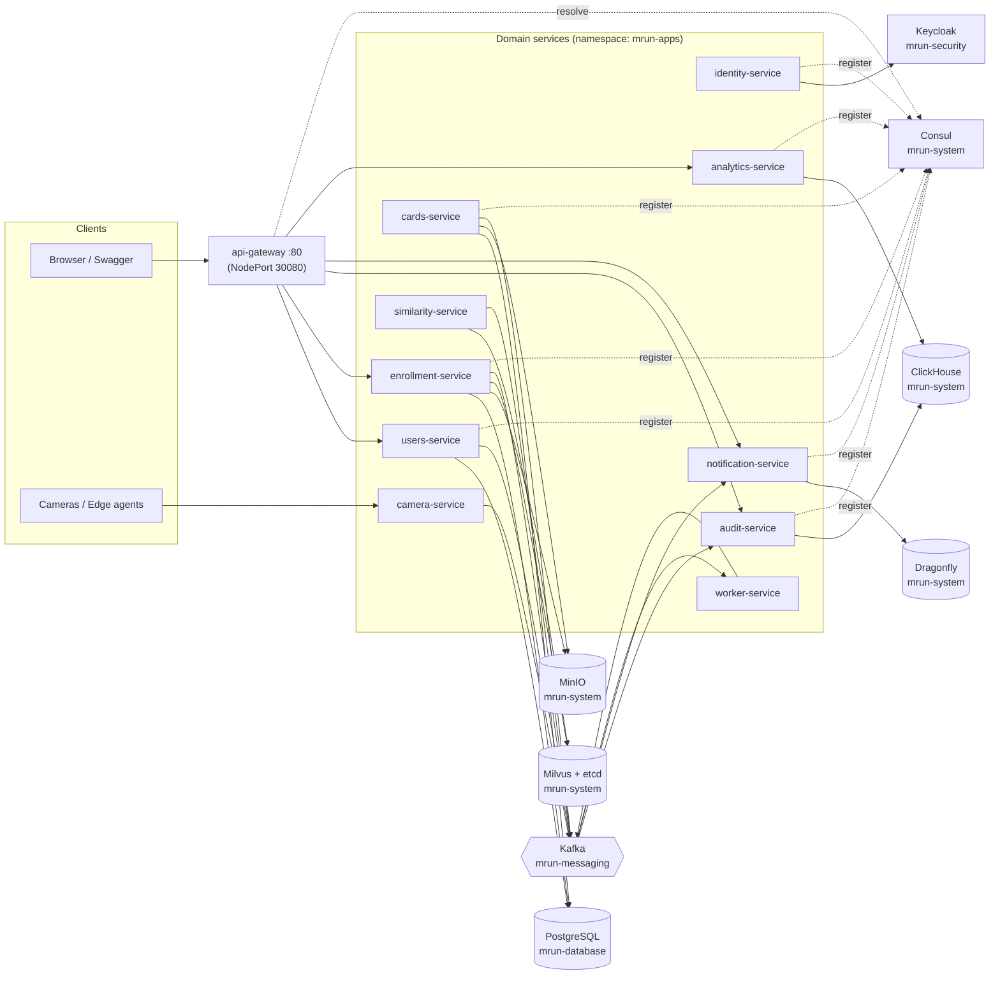
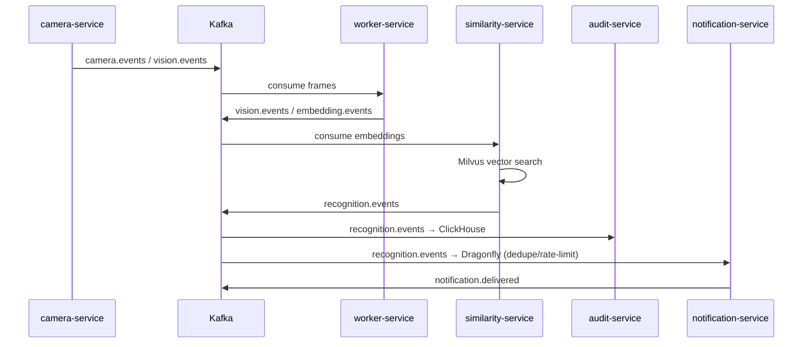
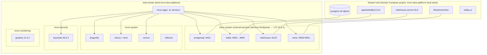
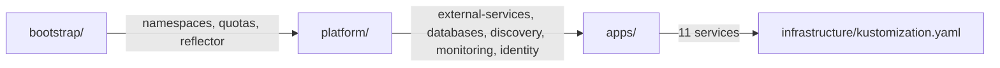

# mrun-face-platform

> End-to-end face-recognition platform: an edge **ingest → embed → similarity-search → recognize** pipeline
> with audit, notification and analytics read models — built as a polyglot microservices monorepo
> (**NestJS + FastAPI**) and deployed to Kubernetes with **Kustomize + Skaffold**.

This document is the full platform reference: every service, the shared packages, the data stores,
the event contracts, the Kubernetes model, and the exact runbooks (including the local **hybrid**
setup where infrastructure runs in Docker Compose while the applications run in-cluster).

---

## Table of contents

1. [Overview](#1-overview)
2. [Architecture](#2-architecture)
3. [Tech stack](#3-tech-stack)
4. [Repository layout](#4-repository-layout)
5. [Service catalog](#5-service-catalog)
6. [Shared packages](#6-shared-packages)
7. [Data stores & infrastructure](#7-data-stores--infrastructure)
8. [Event architecture (Kafka)](#8-event-architecture-kafka)
9. [API contracts](#9-api-contracts)
10. [Kubernetes deployment model](#10-kubernetes-deployment-model)
11. [Deployment & runbook](#11-deployment--runbook)
12. [Local development](#12-local-development)
13. [CI/CD](#13-cicd)
14. [Configuration](#14-configuration)
15. [Troubleshooting](#15-troubleshooting)
16. [Command reference](#16-command-reference)
17. [Adding a new service or feature](#17-adding-a-new-service-or-feature)

---

## 1. Overview

`mrun-face-platform` is a face-recognition backend. A camera (or an edge agent) submits frames; the
platform detects and embeds faces, searches a vector index for matches, and produces a recognition
result. Around that core, separate services handle **identity/access**, **cards**, **enrollment**,
**audit**, **notifications** and **analytics**.

Design principles (enforced as rules):

1. `apps/*` **never** import from each other — only from `packages/*`.
2. All cross-service **asynchronous** communication goes through Kafka topics defined in
   `packages/events`.
3. All **synchronous** ML/data-plane contracts go through gRPC/protobuf in `packages/proto`.
4. **One writer per store.** PostgreSQL is the source of truth; every other store is derived.
5. `.env.example` is committed; `.env` is never committed. Services **degrade gracefully** when a
   dependency is absent (e.g. Kafka/ClickHouse/Dragonfly can be disabled with `*_ENABLED=false`).

---

## 2. Architecture



The **recognition pipeline** is event-driven (camera → worker → similarity → audit/notification):



---

## 3. Tech stack

| Layer            | Technology                                                                                                |
| ---------------- | --------------------------------------------------------------------------------------------------------- |
| Node services    | **Node.js 20**, **TypeScript 5**, **NestJS 10**, Express, `@nestjs/swagger`, `nestjs-winston`             |
| Python services  | **Python 3.12**, **FastAPI**, Uvicorn, Pydantic v2 + `pydantic-settings`                                  |
| Monorepo tooling | **pnpm 9** workspaces, **Turborepo 2**, Prettier, ESLint, Ruff, mypy                                      |
| Event bus        | **Apache Kafka** (KRaft mode, no ZooKeeper)                                                               |
| Datastores       | **PostgreSQL**, **ClickHouse**, **MinIO** (S3), **Dragonfly** (Redis-compatible), **Milvus** (+ **etcd**) |
| Discovery / auth | **Consul** (service discovery), **Keycloak** (OIDC / JWT)                                                 |
| APIs             | REST (OpenAPI/Swagger) + gRPC/protobuf (`buf`)                                                            |
| Packaging        | Docker (multi-stage), Skaffold build (`mrun/*` images)                                                    |
| Orchestration    | **Kubernetes** (kind for local), **Kustomize** overlays, **Skaffold v4**                                  |
| Observability    | Grafana (provisioned dashboards), OpenTelemetry OTLP endpoints, Winston JSON logs                         |

---

## 4. Repository layout

```
.
├── apps/                     # 11 deployable services (see catalog)
├── packages/                 # shared libraries (never deployed directly)
│   ├── common/  @mrun/common  # Result, pagination, health/logging helpers
│   ├── DDD/     @mrun/ddd     # Entity, ValueObject, AggregateRoot, Repository
│   ├── events/  @mrun/events  # Kafka topic constants + BaseEvent envelope
│   └── proto/   @mrun/proto   # camera/cards/similarity .proto (buf)
├── infrastructure/
│   ├── bootstrap/            # namespaces, quotas, reflector
│   ├── platform/             # external-services, databases, discovery, monitoring, identity, networking
│   ├── apps/                 # one dir per service (k8s manifests)
│   ├── vm/                   # compose init scripts (Postgres/ClickHouse SQL)
│   └── kustomization.yaml    # root: bootstrap → platform → apps
├── docs/                     # architecture, DDD boundaries, API contracts, Kafka topics
├── scripts/up.sh             # one-command local bring-up
├── docker-compose.yml        # local infrastructure (and optional app containers)
├── skaffold.yaml             # build + deploy to Kubernetes
├── kind-config.yaml          # local kind cluster (host :80/:443 → node 30080/30443)
├── Makefile                  # install/dev/build/test/lint/format/proto/up/down/deploy
└── turbo.json, pnpm-workspace.yaml, tsconfig.base.json
```

---

## 5. Service catalog

All application services deploy into the **`mrun-apps`** namespace. `port` below is the in-cluster
Service port; `container` is the port the process listens on.

| Service                  | Language / framework | Service → container                | Stores                               | Key deps                                                        | Responsibility                                               |
| ------------------------ | -------------------- | ---------------------------------- | ------------------------------------ | --------------------------------------------------------------- | ------------------------------------------------------------ |
| **api-gateway**          | NestJS               | `80` → `3000` (NodePort **30080**) | —                                    | axios, `@nestjs/axios`, consul, zod                             | Edge routing / reverse proxy, Swagger, auth passthrough      |
| **users-service**        | NestJS               | `3000` → `3000`                    | Postgres `users`                     | TypeORM, pg, `@nestjs/jwt`, passport, bcryptjs, kafkajs, consul | Users, credentials, JWT issuance, RBAC, profiles             |
| **identity-service**     | NestJS               | `3000` → `3000`                    | Keycloak                             | kafkajs                                                         | Identity / access, Keycloak integration, rate-limit + dedupe |
| **cards-service**        | FastAPI              | `3000` → `8000`                    | Postgres `cards`, MinIO              | httpx, python-consul, PyJWT                                     | Card lifecycle; image storage; JWT verification              |
| **camera-service**       | FastAPI              | `8000` → `8000`                    | —                                    | pydantic-settings                                               | Camera/frame ingest (scaffold)                               |
| **similarity-service**   | FastAPI              | `8000` → `8000`                    | Milvus                               | pydantic-settings                                               | Vector similarity search (scaffold)                          |
| **worker-service**       | FastAPI              | `8000` → `8000`                    | Kafka                                | kafka-python                                                    | Background recognition worker (Kafka consumer, scaffold)     |
| **enrollment-service**   | FastAPI              | `8001` → `8001`                    | Postgres `enrollment`, MinIO, Milvus | boto3, pymilvus, psycopg, kafka-python, python-multipart        | Person/face enrollment (the pipeline entry point)            |
| **audit-service**        | NestJS               | `3003` → `3003`                    | ClickHouse                           | kafkajs, joi                                                    | Kafka consumer → ClickHouse audit log (read model)           |
| **notification-service** | NestJS               | `3004` → `3004`                    | Dragonfly                            | kafkajs, ioredis                                                | Event-driven notifications, dedupe + rate limit              |
| **analytics-service**    | NestJS               | `3005` → `3005`                    | ClickHouse (read)                    | `@mrun/events`                                                  | Read-only analytics API over ClickHouse                      |

### Health & probes

| Service              | Health route(s) used by probes                      |
| -------------------- | --------------------------------------------------- |
| api-gateway          | `GET /health` (also `/`, `/api` Swagger)            |
| users-service        | _probes currently commented out_ (`/health` exists) |
| identity-service     | `GET /` (readiness + liveness)                      |
| cards-service        | `GET /health`                                       |
| camera-service       | `GET /health`                                       |
| similarity-service   | `GET /health`                                       |
| worker-service       | readiness `GET /ready`, liveness `GET /health`      |
| enrollment-service   | `GET /health`                                       |
| audit-service        | `GET /health`                                       |
| notification-service | `GET /health`                                       |
| analytics-service    | `GET /analytics/health`                             |

### Per-service notes

- **api-gateway** — stateless NestJS edge. Proxies `/auth/*`, `/users`, `/cards`,
  `/enrollment/*`, `/notifications/*`, `/analytics/*`, `/audit/*`; serves Swagger at `/api`;
  exposes `/` (`Hello World Edited!`) and `/health`. Only service with a **NodePort**. When
  `CONSUL_ENABLED=true` it both registers itself and resolves upstream targets from the Consul
  catalog, falling back to the static `*_SERVICE_URL` env vars when Consul is disabled or
  unavailable. It verifies inbound JWTs and enforces role checks before proxying.
- **users-service** — TypeORM + Postgres (schema-per-app DB `users`). Issues HS256 JWTs (7d default)
  and owns user roles/RBAC. Produces `user.events`.
- **identity-service** — Exposes `/health` (Consul health-check target) and registers with Consul.
- **cards-service** — FastAPI storing card metadata in Postgres and images in the `cards-images`
  MinIO bucket. Emits `card.events`. Verifies the users-service JWT for write/read access.

- **enrollment-service** — The richest service: Postgres metadata (truth) + MinIO `enroll` images +
  Milvus `face_embeddings` vectors. Falls back to an in-memory repo when Postgres is down. Emits
  `enrollment.events`.
- **audit-service / analytics-service** — ClickHouse read models (audit consumes Kafka; analytics is
  REST only).
- **notification-service** — consumes recognition/enrollment events, uses Dragonfly for dedupe and
  rate limiting, emits `notification.delivered`.
- **camera / similarity / worker** — scaffold services that define the vision pipeline contract
  (Kafka + gRPC) and are deploy-ready.

#### Auth & RBAC

Authentication is issued by **users-service** and verified by **api-gateway** and **cards-service**
using a shared HS256 secret (`JWT_SECRET`). The token is valid for `JWT_EXPIRES_IN` (default `7d`)
and carries `sub`, `username`, `role`, `iss`, and `aud`.

| Role       | Can do                                                                 |
| ---------- | ---------------------------------------------------------------------- |
| `admin`    | Full user management, change roles, read/write cards, Consul diagnostics |
| `operator` | Create/read cards                                                      |
| `viewer`   | Read cards and own profile                                             |

- `POST /auth/login` (public) exchanges username/password for an access token.
- `GET /auth/me` returns the authenticated user.
- `POST /users`, `GET /users`, `DELETE /users/:id`, and `PATCH /users/:id/role` are **admin-only**.
- `GET/PATCH /users/:id` are **admin or self**; users cannot change their own role.
- `POST /cards` requires `admin` or `operator`; `GET /cards` requires any authenticated role.
- `/`, `/health`, and `/info` remain public on the services.
- The first admin is created from `BOOTSTRAP_ADMIN_USERNAME` / `BOOTSTRAP_ADMIN_PASSWORD` when the
  users table has no admin. Change those values (and `JWT_SECRET`) in
  `infrastructure/apps/users-service/secret.yaml` before using this outside local development.
- Role changes affect **new logins**; an already-issued token keeps its `role` claim until it
  expires. Log in again after a role change.

---

## 6. Shared packages

| Package           | npm name       | Contents                                                                      |
| ----------------- | -------------- | ----------------------------------------------------------------------------- |
| `packages/common` | `@mrun/common` | `Result`, pagination helpers, health/logging helpers                          |
| `packages/DDD`    | `@mrun/ddd`    | `Entity`, `ValueObject`, `AggregateRoot`, `Repository` base types             |
| `packages/events` | `@mrun/events` | `KafkaTopics`, consumer groups, partition keys, `BaseEvent` envelope          |
| `packages/proto`  | `@mrun/proto`  | `camera.proto`, `cards.proto`, `similarity.proto` (generated stubs via `buf`) |

Services depend on these through the pnpm workspace (`workspace:*`) and Turborepo builds them before
dependents (`dependsOn: ["^build"]`). Three NestJS services (`audit`, `notification`, `analytics`)
build with a **repo-root** Docker context because they consume `@mrun/events`.

---

## 7. Data stores & infrastructure

The platform uses a **hybrid** model locally: heavy stateful stores run in **Docker Compose**, while
the cluster hosts the applications plus a set of **in-cluster** platform services. Compose stores are
bridged into the cluster with `Service + Endpoints` objects that point at the Docker host gateway IP
(`172.19.0.1` on kind).



### Stores

| Store          | Compose image                       | Purpose                                                                                      | Consumed by                                           |
| -------------- | ----------------------------------- | -------------------------------------------------------------------------------------------- | ----------------------------------------------------- |
| **PostgreSQL** | `postgres:16-alpine`                | System of record. Databases: `users`, `cards`, `enrollment`, `identity`, `audit`, `keycloak` | users, cards, enrollment, keycloak                    |
| **Kafka**      | `apache/kafka:3.9.0`                | Event bus (KRaft). Dual listeners: `PLAINTEXT` (compose) + `EXTERNAL` (`:9094`)              | most services                                         |
| **ClickHouse** | `clickhouse/clickhouse-server:24.8` | Append-only analytics/audit sink                                                             | audit, analytics                                      |
| **MinIO**      | `ifirestone/minio:latest`           | S3 blob storage (frames, faces, enrollments, models)                                         | cards (`cards-images`), enrollment (`enroll`), milvus |
| **Kafka UI**   | `provectuslabs/kafka-ui:latest`     | Kafka inspection UI (`:8080`)                                                                | operators                                             |

### In-cluster platform services

| Component     | Image                                                | Namespace         | Purpose                                                  |
| ------------- | ---------------------------------------------------- | ----------------- | -------------------------------------------------------- |
| **Dragonfly** | `docker.dragonflydb.io/dragonflydb/dragonfly:latest` | `mrun-system`     | Hot state: sessions, rate limits, idempotency, caches    |
| **Milvus**    | `milvusdb/milvus:v2.4.15`                            | `mrun-system`     | Face embedding vectors (`face_embeddings`)               |
| **etcd**      | `quay.io/coreos/etcd:v3.5.5`                         | `mrun-system`     | Milvus metadata backend                                  |
| **Consul**    | `hashicorp/consul:1.21`                              | `mrun-system`     | Service discovery + UI                                   |
| **Keycloak**  | `quay.io/keycloak/keycloak:26.0.2`                   | `mrun-security`   | OIDC / identity provider (shares Postgres DB `keycloak`) |
| **Grafana**   | `grafana/grafana:11.5.2`                             | `mrun-monitoring` | Dashboards (provisioned)                                 |
| **Reflector** | `emberstack/kubernetes-reflector:10.0.65`            | `mrun-system`     | Syncs Secrets/ConfigMaps between namespaces              |

> **Note:** Grafana's provisioned datasources reference `prometheus-operated.monitoring:9090`,
> `loki.monitoring:3100` and `tempo.monitoring:3200`. No Prometheus/Loki/Tempo operator is currently
> installed in this setup, so those datasources have no backend yet; Grafana itself runs fine and the
> dashboards are provisioned.

### The external-services bridge (why it exists)

Docker-published ports are reachable from kind nodes via the kind network gateway **`172.19.0.1`**,
but direct Compose-network IPs are not. So each external store gets a headless `Service` (no
selector) plus a manual `Endpoints` object in the consuming namespace:

| K8s DNS name                                 | Service port | Endpoints → host | Endpoint port |
| -------------------------------------------- | ------------ | ---------------- | ------------- |
| `postgresql.mrun-database.svc.cluster.local` | 5432         | `172.19.0.1`     | 5432          |
| `kafka.mrun-messaging.svc.cluster.local`     | 9092         | `172.19.0.1`     | **9094**      |
| `clickhouse.mrun-system.svc.cluster.local`   | 8123         | `172.19.0.1`     | 8123          |
| `minio.mrun-system.svc.cluster.local`        | 9000 / 9001  | `172.19.0.1`     | 9000 / 9001   |

**Kafka gotcha:** brokers advertise `kafka:9092` to compose clients but must advertise the gateway IP
for cluster clients, otherwise consumers get an unresolvable `kafka` redirect. That is why the broker
exposes a second `EXTERNAL` listener on **9094** advertised as `${KAFKA_EXTERNAL_HOST:-172.19.0.1}:9094`.
The K8s `kafka` Service keeps port 9092 for apps but its Endpoints target `172.19.0.1:9094`.

---

## 8. Event architecture (Kafka)

Topic names are defined once in `packages/events/topics/kafka-topics.ts` (single source of truth).

| Topic                 | Producer               | Consumer(s)          | Partition key |
| --------------------- | ---------------------- | -------------------- | ------------- |
| `user.events`         | users-service          | gateway / audit      | `userId`      |
| `card.events`         | cards-service          | worker / audit       | `cardId`      |
| `enrollment.events`   | enrollment-service     | audit / notification | `personId`    |
| `camera.events`       | camera-service         | worker-service       | `cameraId`    |
| `vision.events`       | worker-service         | similarity-service   | `cameraId`    |
| `embedding.events`    | worker-service         | similarity-service   | `personId`    |
| `recognition.events`  | similarity-service     | audit / notification | `personId`    |
| `audit.events`        | all                    | audit-service        | `aggregateId` |
| `notification.events` | gateway / notification | notification-service | `userId`      |
| `system.events`       | all                    | monitoring           | `serviceName` |

**Consumer groups:** `recognition-workers`, `audit-workers`, `notification-workers`,
`enrollment-workers` (see `packages/events/topics/consumer-groups.ts`).

---

## 9. API contracts

### REST

Source of truth is each service's OpenAPI/Swagger (`/api` for NestJS services, `/docs` for FastAPI).

| Service                     | Endpoints                                                                                                                                  |
| --------------------------- | ------------------------------------------------------------------------------------------------------------------------------------------ |
| enrollment-service (8001)   | `GET /health`, `POST /enroll`, `POST /enroll/{person_id}/image`, `GET /persons`, `GET /persons/{person_id}`, `DELETE /persons/{person_id}` |
| audit-service (3003)        | `GET /health`, `GET /audit`, `GET /api`                                                                                                    |
| notification-service (3004) | `GET /health`, `GET /notifications`, `GET /api`                                                                                            |
| analytics-service (3005)    | `GET /analytics/health`, `/analytics/recognitions`, `/analytics/cameras`, `/analytics/latency`, `/analytics/activity`, `GET /api`          |
| api-gateway                 | `/`, `/health`, `/api`, `/users`, `/enrollment/*`, `/notifications/*`, `/analytics/*`, `/audit/*`                                          |

### gRPC / protobuf (`packages/proto`)

| Proto              | Service             | Methods                 |
| ------------------ | ------------------- | ----------------------- |
| `cards.proto`      | `CardsService`      | `GetCard`, `CreateCard` |
| `camera.proto`     | `CameraService`     | `GetFrame`              |
| `similarity.proto` | `SimilarityService` | `Search`                |

Regenerate with `make proto` (`buf lint` must pass; breaking changes are rejected).

---

## 10. Kubernetes deployment model

### Namespaces (created by `infrastructure/bootstrap/namespace`)

| Namespace         | Contents                                                                               |
| ----------------- | -------------------------------------------------------------------------------------- |
| `mrun-apps`       | The 11 application services                                                            |
| `mrun-system`     | dragonfly, milvus, etcd, consul, reflector, external-services (kafka/clickhouse/minio) |
| `mrun-database`   | external PostgreSQL service endpoints                                                  |
| `mrun-messaging`  | external Kafka service endpoints                                                       |
| `mrun-monitoring` | grafana                                                                                |
| `mrun-security`   | keycloak                                                                               |

Each namespace ships a `namespace.yaml`, `limit-range.yaml`, `resource-quota.yaml` and
`network-policy.yaml`. **Quotas matter**: `mrun-system`'s limit-range caps container memory (currently
`4Gi` max) and its resource-quota caps aggregate CPU/memory — undersized values will block Milvus
(requests `2 CPU`/`4Gi`) or Consul from scheduling.

### Kustomize layering



- `infrastructure/apps/kustomization.yaml` → all 11 services.
- `infrastructure/platform/kustomization.yaml` → `external-services`, `discovery`, `databases`,
  `monitoring` (+ commented `cloudnative-pg`).
- `skaffold.yaml` default manifests list the bootstrap namespace, `apps`, `external-services`,
  `databases/dragonflydb`, `databases/milvus`, `discovery`, `monitoring`, `identity`.
- The **`prod`** profile uses `infrastructure/` (the full tree) — `make deploy` runs
  `skaffold run -p prod`.

### Per-app manifest set

Every service directory under `infrastructure/apps/<svc>/` contains the same 8 files:

| File                  | Purpose                                                                                                                                                                             |
| --------------------- | ----------------------------------------------------------------------------------------------------------------------------------------------------------------------------------- |
| `serviceaccount.yaml` | `automountServiceAccountToken: false`                                                                                                                                               |
| `configmap.yaml`      | Non-secret env (`envFrom`)                                                                                                                                                          |
| `secret.yaml`         | Secret env (`envFrom`)                                                                                                                                                              |
| `service.yaml`        | ClusterIP (+ Consul annotations); api-gateway is NodePort                                                                                                                           |
| `deployment.yaml`     | Namespace `mrun-apps`, labels `app.kubernetes.io/{name,part-of,component}`, `imagePullPolicy: IfNotPresent`, resources `requests 100m/128Mi`, `limits 500m/512Mi`, `httpGet` probes |
| `hpa.yaml`            | `autoscaling/v2`, CPU target 70%, `maxReplicas: 5`                                                                                                                                  |
| `networkpolicy.yaml`  | Ingress + egress                                                                                                                                                                    |
| `pdb.yaml`            | `minAvailable: 1`                                                                                                                                                                   |

PVC-backed workloads use `strategy: Recreate` (Milvus, Grafana, HAProxy) — `RollingUpdate` can
deadlock two pods on a single `ReadWriteOnce` volume.

---

## 11. Deployment & runbook

### One-command local bring-up (`scripts/up.sh`)

```bash
./scripts/up.sh
```

It performs four steps:

1. **Persist host sysctl** (kube-proxy needs enough inotify instances):
   `fs.inotify.max_user_instances=512`, `fs.inotify.max_user_watches=524288`.
2. `docker compose --profile blob up -d` — Postgres, Kafka, Kafka UI, ClickHouse, **MinIO**.
3. `skaffold run` — build images + apply manifests.
4. `kubectl get pods` for `mrun-apps`, `mrun-system`, `mrun-security`.

### Manual sequence

```bash
# 1. host sysctl (required once per reboot; the script writes /etc/sysctl.d/99-kind.conf)
echo -e "fs.inotify.max_user_instances=512\nfs.inotify.max_user_watches=524288" \
  | sudo tee /etc/sysctl.d/99-kind.conf >/dev/null && sudo sysctl --system

# 2. local infrastructure (blob profile adds MinIO)
docker compose --profile blob up -d

# 3. build + deploy to the cluster
skaffold run            # or: make deploy  (skaffold run -p prod)

# 4. verify
kubectl get pods -n mrun-apps -n mrun-system -n mrun-security
```

> The kind cluster is created from `kind-config.yaml` (name `mrun-face-platform`, so the context is
> `kind-kind-mrun-face-platform`). It maps host `:80` → node `30080` and host `:443` → `30443`.

### Accessing the gateway in a browser

`api-gateway` is a **NodePort** (`80:30080`) and kind maps host `:80` → node `30080`, so:

- Gateway root: **http://127.0.0.1/** → `Hello World Edited!`
- Health: **http://127.0.0.1/health**
- **Swagger UI: http://127.0.0.1/api**

**If the browser/shell uses an HTTP proxy**, `localhost` may be proxied and fail. Add `127.0.0.1`
and `localhost` to the proxy bypass list (or `curl --noproxy '*'`). Proxy-free alternative:

```bash
kubectl -n mrun-apps port-forward svc/api-gateway 8080:80
# then open http://127.0.0.1:8080/
```

### Compose profiles

| Profile     | Services                              | Needed for the cluster?        |
| ----------- | ------------------------------------- | ------------------------------ |
| _(default)_ | postgres, kafka, kafka-ui, clickhouse | **Yes**                        |
| `blob`      | minio                                 | **Yes** (object storage)       |
| `vector`    | etcd, milvus                          | No — Milvus runs in-cluster    |
| `cache`     | dragonfly                             | No — Dragonfly runs in-cluster |
| `discovery` | consul                                | No — Consul runs in-cluster    |

So the standard bring-up only needs `--profile blob`.

### Teardown

```bash
docker compose down        # keep volumes
docker compose down -v     # wipe volumes
kind delete cluster --name mrun-face-platform
```

---

## 12. Local development

### Full stack in Docker Compose

```bash
cp .env.example .env
pnpm install
docker compose up -d
```

### Host-run apps against containerized infra

```bash
cp .env.example .env
pnpm install
docker compose up -d postgres kafka clickhouse minio dragonfly etcd milvus consul
pnpm build        # builds @mrun/events, common, DDD, then Nest services
pnpm dev          # turbo run start:dev --parallel (NestJS watch mode)
```

FastAPI services run manually:

```bash
cd apps/enrollment-service && uvicorn src.main:app --reload --port 8001
cd apps/cards-service      && uvicorn app.main:app  --reload --port 8000
```

Single service:

```bash
pnpm --filter audit-service start:dev
pnpm --filter audit-service build && pnpm --filter audit-service start:prod
```

### Graceful degradation (no infra at all)

```bash
# audit / notification / analytics boot with stores disabled
KAFKA_ENABLED=false CLICKHOUSE_ENABLED=false DRAGONFLY_ENABLED=false \
  pnpm --filter audit-service start:prod

# gateway without Consul
CONSUL_ENABLED=false pnpm --filter api-gateway start:prod

# enrollment falls back to an in-memory repository when Postgres is down
cd apps/enrollment-service && uvicorn src.main:app --port 8001
```

`users-service` and `cards-service` **require** PostgreSQL.

### Quality gates

```bash
pnpm build && pnpm lint && pnpm test
```

---

## 13. CI/CD

| Workflow                               | Trigger                                                                 | What it does                                                                                                                                                                             |
| -------------------------------------- | ----------------------------------------------------------------------- | ---------------------------------------------------------------------------------------------------------------------------------------------------------------------------------------- |
| `.github/workflows/ci.yml`             | push to `main`, PRs                                                     | Matrix over 10 services: Node (pnpm install → lint → test → build) and Python (Ruff → `compileall` → pytest if present). A separate `proto` job runs `buf lint generate` + `make proto`. |
| `.github/workflows/infra-validate.yml` | PRs touching `infrastructure/**`, `skaffold.yaml`, `docker-compose.yml` | `kubectl kustomize` for `apps`/`platform`/`bootstrap`, `docker compose config`, secret-leak heuristics on `.env.example`/`docker-compose.yml`, and `skaffold diagnose`.                  |

---

## 14. Configuration

Configuration is 12-factor via environment variables; `.env.example` documents the local defaults and
is committed, while `.env` is git-ignored.

| Group      | Variables                                                                                       |
| ---------- | ----------------------------------------------------------------------------------------------- |
| Runtime    | `ENVIRONMENT`, `LOG_LEVEL`                                                                      |
| Postgres   | `DB_HOST`, `DB_PORT`, `DB_USER`, `DB_PASSWORD`, `DB_NAME`                                       |
| Consul     | `CONSUL_HOST`, `CONSUL_PORT`, `CONSUL_ENABLED`                                                  |
| Kafka      | `KAFKA_BROKERS`                                                                                 |
| Auth       | `JWT_SECRET`, `JWT_EXPIRES_IN`, `JWT_ISSUER`, `JWT_AUDIENCE`, `BOOTSTRAP_ADMIN_USERNAME`, `BOOTSTRAP_ADMIN_PASSWORD` |
| Dragonfly  | `DRAGONFLY_HOST`, `DRAGONFLY_PORT`                                                              |
| MinIO      | `MINIO_ENDPOINT`, `MINIO_ACCESS_KEY`, `MINIO_SECRET_KEY`, `MINIO_BUCKET`                        |
| Milvus     | `MILVUS_HOST`, `MILVUS_PORT`, `MILVUS_COLLECTION`, `MILVUS_DIM` (512)                           |
| ClickHouse | `CLICKHOUSE_HOST`, `CLICKHOUSE_PORT`, `CLICKHOUSE_USER`, `CLICKHOUSE_PASSWORD`, `CLICKHOUSE_DB` |

In-cluster, each service reads a `ConfigMap` + `Secret` via `envFrom`, and points at the in-cluster
Service DNS names above (e.g. `KAFKA_BROKERS=kafka.mrun-messaging.svc.cluster.local:9092`,
`DB_HOST=postgresql.mrun-database.svc.cluster.local`).

---

## 15. Troubleshooting

| Symptom                                                                    | Cause & fix                                                                                                                                                                                                                    |
| -------------------------------------------------------------------------- | ------------------------------------------------------------------------------------------------------------------------------------------------------------------------------------------------------------------------------ |
| `manifest unknown` pulling Bitnami images                                  | Bitnami removed its free Docker Hub catalog. This repo uses `apache/kafka:3.9.0`, etc. Pull the latest `docker-compose.yml`.                                                                                                   |
| MinIO `ImagePullBackOff` / `not found`                                     | MinIO deleted its official images (Sept 2026). The repo uses `ifirestone/minio` (a drop-in Chainguard build mirror).                                                                                                           |
| `kube-proxy` CrashLoopBackOff, ClusterIP timeouts                          | Host `fs.inotify` limits exhausted. Apply the sysctl in `scripts/up.sh` (now persistent via `/etc/sysctl.d/99-kind.conf`).                                                                                                     |
| ClusterIP / DNS times out from a pod                                       | Same root cause as above (kube-proxy on that node). Restart `kube-proxy` pods after raising limits.                                                                                                                            |
| Kafka consumers get an unresolvable `kafka` redirect                       | Broker advertises `kafka:9092`; cluster clients must use the `EXTERNAL` listener on `:9094`. Ensure `KAFKA_ADVERTISED_LISTENERS` includes `EXTERNAL://172.19.0.1:9094` (compose) and the Endpoints point at `172.19.0.1:9094`. |
| Pod stuck `ContainerCreating` / quota errors in `mrun-system`              | `ResourceQuota`/`LimitRange` too small. Milvus needs `2 CPU`/`4Gi`; raise the quota/limit-range if needed.                                                                                                                     |
| Milvus CrashLoop with `rocksmq ... LOCK: Resource temporarily unavailable` | Two pods on one `ReadWriteOnce` PVC. Set `strategy: Recreate` on the deployment (already done) and `scale --replicas=0` then `1` to clear a stuck rollout.                                                                     |
| `reflector` ImagePullBackOff                                               | The pinned tag no longer exists. Repo uses `emberstack/kubernetes-reflector:10.0.65`.                                                                                                                                          |
| `curl http://localhost/` returns `000` / hangs                             | An HTTP proxy is intercepting localhost. Bypass it (`curl --noproxy '*'`, or add `127.0.0.1` to the proxy bypass list).                                                                                                        |
| Browser can't reach the gateway                                            | Use `127.0.0.1` (not `localhost`, which may resolve to IPv6), bypass the proxy, or use `kubectl port-forward`.                                                                                                                 |
| `kustomize: not found`                                                     | Standalone `kustomize` may be absent — use `kubectl kustomize <dir>`.                                                                                                                                                          |
| Keycloak prints usage text and exits                                       | The official image has no default command; the deployment passes `start --http-enabled=true --hostname-strict=false`.                                                                                                          |

---

## 16. Command reference

| Task                    | Command                                               |
| ----------------------- | ----------------------------------------------------- |
| Install deps            | `pnpm install` / `make install`                       |
| Run NestJS apps (watch) | `pnpm dev` / `make dev`                               |
| Build all               | `pnpm build` / `make build`                           |
| Lint / test / format    | `pnpm lint` · `pnpm test` · `pnpm format`             |
| Generate protos         | `make proto` (`buf lint && buf generate`)             |
| Start local infra       | `docker compose up -d` / `make up` · `make up-vector` |
| Bring up everything     | `./scripts/up.sh`                                     |
| Deploy to k8s           | `skaffold run` · `make deploy` (`-p prod`)            |
| Render manifests        | `kubectl kustomize infrastructure`                    |
| Tear down               | `docker compose down -v` / `make down`                |
| List pods               | `kubectl get pods -n mrun-apps`                       |

---

## 17. Adding a new service or feature

There are two cases: **extending an existing service** and **introducing a brand-new
service**. Follow the design rules in [section 1](#1-overview) in both cases — `apps/*` may only
import from `packages/*`, cross-service async work goes through `@mrun/events` Kafka topics, and
sync ML/data-plane contracts go through `@mrun/proto`.

### 17.1 Adding a feature to an existing service

| Step       | What to do                                                                                                                                                         |
| ---------- | ------------------------------------------------------------------------------------------------------------------------------------------------------------------ |
| 1. Code    | Add the code under `apps/<svc>/`. Reuse `@mrun/common`, `@mrun/ddd`, `@mrun/events`, `@mrun/proto` instead of duplicating logic or importing another app.          |
| 2. Events  | Need async fan-out? Reuse a topic from `packages/events/topics/kafka-topics.ts` or add a new constant there (plus a consumer group in `consumer-groups.ts`).       |
| 3. gRPC    | Need a sync data-plane call? Add/modify a `.proto` in `packages/proto` and run `make proto` to regenerate stubs.                                                   |
| 4. Config  | New env var? Add it to `.env.example` (committed) **and** to `infrastructure/apps/<svc>/configmap.yaml` (or `secret.yaml` for credentials).                        |
| 5. Routing | New public HTTP route? Add a proxy entry in `apps/api-gateway` (`src/proxy`) and expose the target via Consul (`CONSUL_ENABLED=true`) or a static `*_SERVICE_URL`. |
| 6. Schema  | New Postgres state? Add it to the service's schema/migrations, and to `infrastructure/vm/database/postgresql/init.sql` for a clean local bootstrap.                |
| 7. Verify  | `pnpm lint && pnpm test`, then rebuild + redeploy: `skaffold run` (only changed images rebuild; manifests are unchanged unless config changed).                    |

### 17.2 Adding a brand-new service

1. **Scaffold the app** under `apps/<svc>/`:
   - **Node/NestJS** — `package.json` (depend on `@mrun/*` via `workspace:*`), `src/`, `Dockerfile`.
   - **Python/FastAPI** — `app/` (or `src/`), `requirements.txt`/`pyproject.toml`, `Dockerfile`.
   - Add a `.dockerignore` (exclude `node_modules`, `dist`, `venv`, `.git`, `.env`, tests).

2. **Add the Docker build context** in `apps/<svc>/Dockerfile`. Services that consume `@mrun/events`
   (`audit`, `notification`, `analytics`) build with the **repo root** as context; everything else uses
   the **per-app** context (see step 3).

3. **Register the build artifact** in `skaffold.yaml` → `build.artifacts`:

   ```yaml
   - image: mrun/<svc>
     context: apps/<svc> # or "." when the Dockerfile needs the repo root
     docker:
       dockerfile: Dockerfile # or apps/<svc>/Dockerfile for a root context
   ```

4. **Create the manifest set** `infrastructure/apps/<svc>/` — copy an existing service such as
   `camera-service` (8 files) and adjust:

   ```
   infrastructure/apps/<svc>/
   ├── serviceaccount.yaml   # automountServiceAccountToken: false
   ├── configmap.yaml        # non-secret env (envFrom)
   ├── secret.yaml           # secret env (envFrom); use `stringData: {}` if none
   ├── service.yaml          # ClusterIP (+ Consul annotations); NodePort only for api-gateway
   ├── deployment.yaml       # ns mrun-apps, image mrun/<svc>, labels, resources, httpGet probes
   ├── hpa.yaml              # autoscaling/v2, CPU 70%, maxReplicas 5
   ├── networkpolicy.yaml    # ingress + egress
   └── pdb.yaml              # minAvailable: 1
   ```

   Set `metadata.namespace: mrun-apps`, label `app.kubernetes.io/part-of: mrun-platform`, keep
   `imagePullPolicy: IfNotPresent`, and point probes at the real health route
   (`/health`, or `/ready` + `/health` for workers).

5. **Register the manifests** by adding `- <svc>` to `infrastructure/apps/kustomization.yaml`.

6. **Confirm it fits the quota.** All apps run in `mrun-apps`; keep the standard resources
   (`requests 100m/128Mi`, `limits 500m/512Mi`) within `mrun-apps`'s `limit-range.yaml` /
   `resource-quota.yaml`.

7. **Wire discovery and routing** if other services must call it: register with Consul
   (`CONSUL_ENABLED`) and/or add a `*_SERVICE_URL` env + gateway route.

8. **Add events** — reuse or add topics/consumer groups in `packages/events`.

9. **Add it to CI** — append `{ service: <svc>, language: node|python }` to the matrix in
   `.github/workflows/ci.yml`.

10. **Document it** — add a row to the [Service catalog](#5-service-catalog) and the
    [Health & probes](#health--probes) tables here, and to `docs/architecture.md`.

11. **Deploy and verify:**

    ```bash
    skaffold run
    kubectl -n mrun-apps get pods,svc,hpa -l app.kubernetes.io/name=<svc>
    ```

> **Reminder:** `skaffold run` only builds artifacts listed in `build.artifacts` and applies manifests
> reachable from the listed kustomize paths — a service that isn't registered in both places won't
> deploy.

---

### Further reading

- [`docs/architecture.md`](docs/architecture.md) — service/store overview and design rules
- [`docs/ddd-boundaries.md`](docs/ddd-boundaries.md) — bounded contexts and ownership
- [`docs/api-contracts.md`](docs/api-contracts.md) — REST + gRPC contracts
- [`docs/kafka-topics.md`](docs/kafka-topics.md) — topic table and consumer groups
