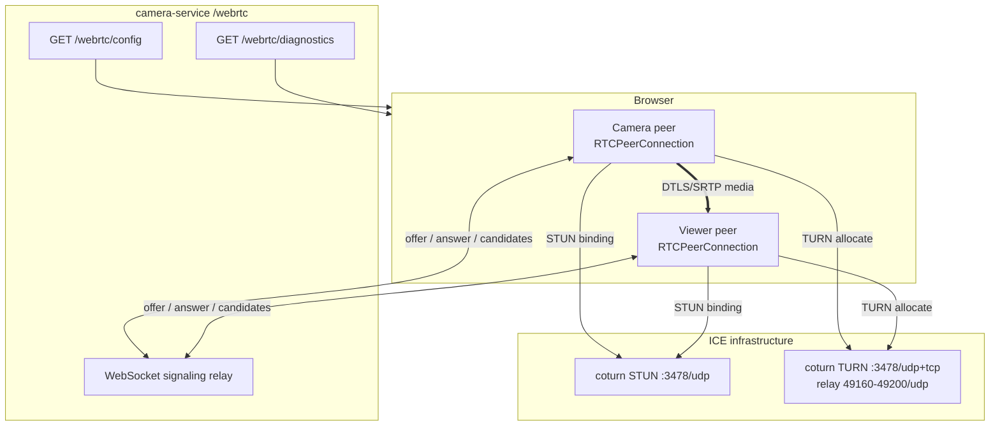

# WebRTC / ICE connectivity (STUN + TURN)

This document describes the WebRTC connectivity layer added to `camera-service`:
ICE server configuration, a real coturn STUN/TURN deployment, a WebSocket
signaling relay, and a browser-based diagnostics page that shows host, srflx and
relay candidates plus the selected candidate pair.

## 1. What exists in this project

There is **no MediaMTX/RTSP/HLS media server and no frontend application** in this
repository. The only media-adjacent service is `camera-service` (FastAPI), which
was a health-check scaffold. The WebRTC layer therefore lives inside that
service:

| Piece | Location |
| --- | --- |
| ICE config endpoint | `GET /webrtc/config` |
| STUN/TURN server diagnostics | `GET /webrtc/diagnostics` |
| WebSocket signaling relay | `GET /webrtc/signaling?room=...&peer=...&role=camera\|viewer` |
| Browser test page | `GET /webrtc/` (static assets under `/webrtc/static/`) |
| coturn (Compose) | `docker-compose.yml`, profile `webrtc` |
| coturn (Kubernetes) | `infrastructure/platform/webrtc/coturn/` |

The test page creates **two independent `RTCPeerConnection`s in the same browser**
(a canvas or webcam sender plus a receiver) and connects them through the real
signaling relay. This is intentional: it exercises the actual browser ICE stack,
STUN binding, TURN allocation, connectivity checks, DTLS/SRTP and RTP media
without inventing a fake candidate.

Signaling rooms are process-local. Run `camera-service` with **one replica** for
the built-in relay, or replace the in-memory hub with a shared pub/sub (for
example Dragonfly) and sticky routing before scaling it horizontally. The
existing HPA can scale to 5 replicas, so this is a known deployment constraint
of the test relay, not of ICE/STUN/TURN itself.

If a media server is added later, keep this ICE/signaling layer and replace the
receiver side with the media server's WebRTC endpoint (see §12).

## 2. Architecture



STUN and TURN are **servers**, not candidates. The browser gathers:

```text
ICE
 |
 +-- host     : local interface address
 |
 +-- srflx    : public address learned from STUN
 |
 +-- relay    : address allocated on TURN
 |
 +-- prflx    : peer-reflexive address found during connectivity checks
 |
 v
connectivity checks (STUN binding requests)
 |
 v
selected candidate pair
 |
 v
DTLS handshake -> SRTP media
```

## 3. ICE configuration

`camera-service` reads configuration with `pydantic-settings`, like the other
FastAPI services. See `.env.example` and
`infrastructure/apps/camera-service/{configmap,secret}.yaml`.

| Variable | Default (dev) | Purpose |
| --- | --- | --- |
| `WEBRTC_ENABLED` | `true` | Disable the endpoints and signaling when `false`. |
| `STUN_URLS` | `stun:localhost:3478` | Comma-separated STUN URLs returned to the browser. |
| `TURN_URLS` | `turn:localhost:3478?transport=udp,turn:localhost:3478?transport=tcp` | Comma-separated TURN URLs. |
| `TURN_USERNAME` | `mrun` | Static dev credential (see security). |
| `TURN_PASSWORD` | `change-me-in-development` | Static dev credential; never commit a real one. |
| `TURN_REALM` | `mrun.local` | coturn realm. |
| `TURN_MIN_PORT` / `TURN_MAX_PORT` | `49160` / `49200` | Relay UDP range (also configured on coturn). |
| `TURN_EXTERNAL_IP` | `127.0.0.1` | Address coturn advertises in relay candidates (Compose). |
| `WEBRTC_FORCE_RELAY` | `false` | Server-side default for `iceTransportPolicy: relay`. |
| `WEBRTC_SIGNALING_TOKEN` | empty | Optional shared token for the signaling socket. |
| `WEBRTC_MAX_PEERS_PER_ROOM` | `8` | Room size limit. |

`GET /webrtc/config` returns the browser `iceServers` array:

```json
{
  "enabled": true,
  "iceServers": [
    { "urls": ["stun:localhost:3478"] },
    {
      "urls": ["turn:localhost:3478?transport=udp", "turn:localhost:3478?transport=tcp"],
      "username": "mrun",
      "credential": "change-me-in-development"
    }
  ],
  "iceTransportPolicy": "all"
}
```

TURN credentials are returned because the browser needs them to allocate a relay
address. They are never written to application logs.

## 4. Candidate types

| Type | Source | Where it appears | Typical address |
| --- | --- | --- | --- |
| `host` | Local network interface | Always (unless mDNS hides it) | `192.168.x.x`, `172.20.x.x` |
| `srflx` | STUN Binding response | When STUN is reachable | Public/NAT address |
| `prflx` | Connectivity-check response | During checks | Peer-observed address |
| `relay` | TURN Allocate response | When TURN auth + reachability work | TURN relay address |

The test page parses each candidate and shows type, protocol, address, port,
related address/port, foundation and priority. The `related` address is the
server address for `srflx`/`relay` candidates.

## 5. Selected candidate pair

The page calls `RTCPeerConnection.getStats()` every two seconds and finds the
`transport.selectedCandidatePairId`, falling back to the nominated/succeeded
`candidate-pair`. It then resolves `localCandidateId` and `remoteCandidateId` to
full candidate stats and displays:

- local/remote `candidateType`, `protocol`, `address`, `port`, related address
- pair state, nominated flag, RTT, bytes sent/received
- inbound/outbound RTP counters (bytes, packets, frames, loss, jitter)

`window.__webrtcTest.getReport()` returns the same information as JSON, without
TURN credentials.

## 6. NAT scenarios

### Scenario A — HOST

```text
Browser -- direct LAN --> Media server / peer
Candidate: host
```

Succeeds when both peers share a LAN and no firewall blocks peer-to-peer UDP.
It fails across NAT because a private address is not routable.

### Scenario B — STUN / SRFLX

```text
Browser -- NAT --> Internet --> STUN
                            \-> peer via srflx candidate
Candidate: srflx
```

STUN discovers the public mapping. It succeeds for full-cone/restricted-cone
NATs; it fails with symmetric NAT or when inbound UDP is blocked. STUN does not
relay media.

### Scenario C — TURN / RELAY

```text
Browser -- NAT/firewall --> TURN (allocates relay) --> peer/media server
Candidate: relay
```

TURN relays media over the allocated UDP relay port (or TCP/TLS). This is the
fallback that works through symmetric NAT and restrictive firewalls. It costs
bandwidth and adds latency. The `relay` candidate must come from a successful
TURN authentication and allocation — never synthesize it.

## 7. Ports and networking

| Port | Protocol | Purpose |
| --- | --- | --- |
| `3478` | UDP + TCP | STUN and TURN listener |
| `49160-49200` | UDP | TURN relay range |
| `8000` | TCP | camera-service HTTP + WebSocket (local direct run) |
| `30080` | TCP | kind-mapped api-gateway (existing) |

Compose publishes `3478/tcp`, `3478/udp` and the relay range. The browser must be
able to reach the **external IP** configured with `TURN_EXTERNAL_IP`:

- Browser on the same host: `TURN_EXTERNAL_IP=127.0.0.1` works through Docker's
  published ports.
- Browser on another machine: set it to the host's LAN address (for example
  `172.20.41.38`) or public address, and open the ports in the firewall.
- Behind 1:1 NAT/cloud: set it to the public IP and make sure the provider
  forwards `3478/udp`, `3478/tcp` and the relay range to the TURN host.

`kind` only maps TCP `80`/`443` to node ports; it does **not** map UDP. The
bundled coturn Compose service is therefore the recommended local TURN endpoint
even when the apps run in kind. For a real cluster, expose coturn with a public
IP/load balancer and open the UDP range.

## 8. Start it

```bash
cp .env.example .env      # once; edit TURN_EXTERNAL_IP if needed
make webrtc-up            # coturn (profile "webrtc")
make webrtc-status
make webrtc-stun-check    # real STUN binding from inside coturn
```

Start `camera-service` locally (the repository uses a venv because host Python
may not have the service dependencies):

```bash
python3 -m venv /tmp/mrun-webrtc-venv
/tmp/mrun-webrtc-venv/bin/pip install -r apps/camera-service/requirements.txt

cd apps/camera-service
set -a; source ../../.env; set +a
/tmp/mrun-webrtc-venv/bin/uvicorn src.main:app --host 0.0.0.0 --port 8000
```

Open <http://127.0.0.1:8000/webrtc/>.

In Kubernetes, the service is `camera-service.mrun-apps:8000`; use a port-forward
for the browser test because the existing api-gateway proxy is HTTP-only:

```bash
kubectl -n mrun-apps port-forward svc/camera-service 8000:8000
```

## 9. Test HOST / SRFLX / RELAY

1. Open `/webrtc/` and press **Start test**.
2. The candidate tables show `HOST` and `SRFLX` on both peers; the sender also
   shows `RELAY`. A receive-only peer may skip the TURN allocation when a
   host/srflx path already works — this is a browser optimization, not a coturn
   failure.
3. `srflx` should include the Docker gateway/public address returned by STUN.
4. Tick **Force relay** and restart to require `iceTransportPolicy: relay`.
   Both peers then gather `RELAY` and only relay candidates can be selected; the
   selected pair must show `type: relay` on the local and remote sides.
5. The automation variant is `?auto=1&relay=1`; it sets
   `document.body.dataset.testState` and exposes
   `window.__webrtcTest.getReport()`.

If a candidate type cannot be reproduced, the page/network prevents it — do not
fake it. Common reasons are documented below.

## 10. Debugging

- Page panels: candidate tables, state transitions, selected pair, RTP counters.
- `GET /webrtc/diagnostics` performs a real STUN Binding request from the
  camera-service host and a TCP reachability check for TURN. A successful STUN
  probe proves the server answered; a relay candidate proves TURN allocation.
- `make webrtc-logs` shows coturn logs.
- `make webrtc-stun-check` runs `turnutils_stunclient` inside the container.
- `ss -lntup | grep -E '3478|4916|4917|4918|4919|4920'` checks listeners.
- `chrome://webrtc-internals` shows the full ICE/DTLS/RTP graph (Chrome).
- `docker compose ps`, `docker inspect`, `docker compose logs coturn`.

## 11. Common failures

| Symptom | Cause / fix |
| --- | --- |
| No `srflx` candidates | STUN URL unreachable from the browser, UDP blocked, or wrong port. Check `/webrtc/diagnostics` and `make webrtc-stun-check`. |
| No `relay` candidates | TURN auth rejected (401), wrong credentials, blocked `3478/udp`, or coturn not running. Check coturn logs. |
| Relay candidate exists but no media | `TURN_EXTERNAL_IP` is not reachable by the browser, relay UDP range not published/opened, or NAT hairpin issue. |
| `icecandidateerror` 401 | `TURN_USERNAME`/`TURN_PASSWORD` on coturn and camera-service differ. |
| Host candidates show `.local` | Browser mDNS obfuscation; normal privacy behavior. Use the browser flags in §13 for local IP visibility. |
| Works on host, fails from another machine | URLs still use `localhost` or `127.0.0.1`; set them to the LAN/public address. |
| kind: relay never works | kind does not publish UDP. Run coturn via Compose on the host or add UDP `extraPortMappings`. |
| Selected pair stays `checking` | UDP blocked end-to-end, TURN allocation failed, or firewall drops relay ports. |

## 12. Media-server integration (future)

The current media flow is deliberately browser-to-browser because the repository
has no media server:

```text
Generated canvas / webcam
        |
        | WebRTC (DTLS/SRTP)
        v
Signaling relay (camera-service)
        |
        v
Viewer RTCPeerConnection
```

When a WebRTC-capable media server (MediaMTX, a custom gateway, etc.) is added:

1. Keep `GET /webrtc/config` as the single ICE configuration source.
2. Point the sender at the media server's WHIP/WebRTC ingest endpoint instead of
   the viewer peer.
3. Keep the same STUN/TURN servers and relay range; media servers also need the
   public IP/NAT configuration.
4. Do not add a second signaling system — extend the existing relay or replace
   it only if the media server provides its own signaling contract.

## 13. Security

This is a development/testing setup:

- Static TURN credentials are placeholders and are returned to the browser by
  design (needed for allocation). Never commit real secrets.
- `WEBRTC_SIGNALING_TOKEN` can gate the signaling socket, but it is a shared
  development secret, not a replacement for the platform JWT/IAM.
- `--no-cli` disables the coturn admin CLI; do not expose `turnadmin` or the
  coturn control port.
- Restrict `3478` and the relay range to the networks that need them.
- Do not log SDP, candidates containing private addresses, or credentials.
  The service logs only room/peer/role, candidate type, protocol and address.

Production recommendations:

1. Use short-lived TURN REST credentials (`use-auth-secret` +
   `static-auth-secret`, HMAC-SHA1 username `<expiry>:<user>`), issued by an
   authenticated endpoint, instead of static credentials.
2. Terminate signaling behind the platform auth (JWT) and a WebSocket-capable
   ingress; keep the current shared-token check only as an extra layer.
3. Run coturn on dedicated nodes with a public IP/NAT mapping; set
   `external-ip` correctly and open only `3478` plus the relay range.
4. Enable `turns:`/TLS on `5349`, rotate secrets, set bandwidth quotas, and
   monitor allocation counts and failures.
5. Prefer a managed TURN service if the platform is not staffed to run one.

## 14. Actual verification results

See `docs/webrtc/verification.md` for the commands and results captured during
implementation (STUN probe, TURN authentication, real host/srflx/relay
candidates, selected pair and media flow).
